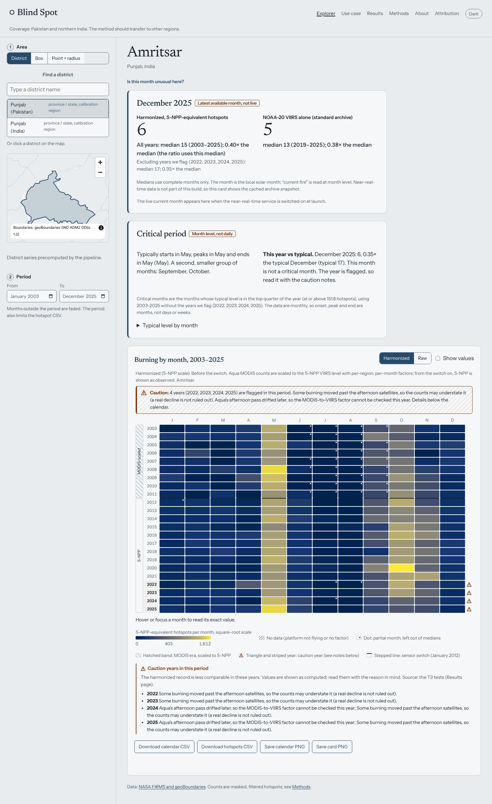

# Blind Spot

Blind Spot puts NASA's MODIS and VIIRS satellite fire detections on one consistent scale, so a fire count for any district in Pakistan and northern India can be compared across 2003 to 2025. It shows a month-by-day burning calendar, compares a month with its usual level, and tests whether the correction still works in recent years. Where it stops working, the app flags those years in plain words instead of hiding it.

Built for the **NASA Space Apps Challenge 2026**, challenge "Harmonization of MODIS and VIIRS Hot Spots". Why: raw fire counts for Punjab jump when the record switches from MODIS to VIIRS in 2012, and a disaster or air-quality team reading the raw series would mistake a sensor change for a change in burning.

> **Status (14 Nov 2026): the hackathon is open; built and tested locally, not yet deployed or submitted.** Submission closes **Sun 15 Nov 2026, 23:59** (Team Owner's local time for the Universal Event). Rules from the 2026 Project Submission Guide: `docs/GUIDE_2026_NOTES.md`. See "Status" below and `YOUR_TASKS/`.



## Key findings

Numbers below are copied from `docs/SUBMISSION.md` and `docs/RESULTS_T1.md` to `docs/RESULTS_T3.md`, which `make story` / the pipeline generate from the results JSON.

- **The 2012 jump is a sensor artefact, and the correction removes it.** Window 15 Oct to 30 Nov 2012: S-NPP VIIRS counted +613% against Aqua MODIS in Pakistani Punjab and +371% in Indian Punjab. After harmonizing: +12.7% (Pakistan) and -6.1% (India), within normal year-to-year spread.
- **After 2021 the correction fails in Indian Punjab** (T1 held-out: fail, 1 of 4 test years inside the 95% interval). The app flags 2022 to 2025 there (2023 to 2025 in Pakistani Punjab).
- **Pakistani Punjab T2 (is the Aqua/S-NPP ratio drifting?) is inconclusive**; Indian Punjab shows no drift on matched days.
- **Why it fails (T3):** burning that moved later in the day, past the afternoon satellites, is supported for Indian Punjab, but we **cannot separate later burning from less burning**.
- **Example:** Sangrur, November 2021, an unflagged year: 1.74 times its 2003–2025 November median (1.62 times if the flagged years are left out) (NOAA-20, a second satellite: 1.94 times). November 2025 looks far lower (0.05 times its median) but sits in a flagged year, so it is not read as "far fewer fires".

Tests and thresholds were written before the data were run (`docs/DECISIONS.md`, D-028, D-039). One T2 rule was changed after seeing data; this is disclosed with both verdicts.

## Features, mapped to the NASA brief

| The challenge asks for | Blind Spot |
|---|---|
| Select an area of interest | 347 districts, region presets, or draw a box or radius |
| Choose a date range | Start and end month controls |
| Calendar view, 2000s to present | Month-by-day calendar, 2003 to 2025, raw or harmonized, sensor eras shaded |
| Current month against the median | Month card (latest archive month for now; live month needs the NRT function and a key, see `docs/NRT.md`) |
| Critical periods | Onset, peak and end month per district/region |
| Accessible colour ramps | Cividis; flags use icon, stripes and text; axe-core 0 violations |
| Download data and images | CSV (calendar or filtered hotspots, up to 200,000 rows), PNG |

Full table and method: `docs/SUBMISSION.md`.

## Repo map

| Path | What |
|---|---|
| `pipeline/blindspot/` | Python 3.11 pipeline: download, ingest, mask, calibrate, tests T1 to T3, app data |
| `tests/` | pytest suite (fixtures only, no network) |
| `web/` | Next.js static export, MapLibre, DuckDB-WASM; one Cloudflare Pages Function for near-real-time data (`web/functions/`) |
| `data/` | Raw and processed data, gitignored, rebuilt by `make data` (the website data in `web/public/data` is tracked) |
| `docs/` | Plan, decisions, checkpoints, results, deploy, submission, video, outreach |
| `docs/screenshots/` | Screenshots from the browser tests |
| `YOUR_TASKS/` | Things only the human can do, in date order |
| `docs/CONTINUE.md` | How to continue after the original chat ends |
| `docs/chat/` | Exported chat log (see its README) |
| `HANDOFF.md`, `CLAUDE.md` | Handoff note and the rules for any Claude session |

## Quick start (Mac or Linux)

Needs Python 3.11, Node, and network access to NASA FIRMS and GitHub (for boundaries).

```
make install      # venv + dependencies
make data         # OPTIONAL: re-run the science from raw NASA data (about an hour, ~1.3 GB raw)
make test         # lint + pytest
make web          # build and serve http://localhost:4173
```

Other commands: `make web-test` (lint, types, vitest, Playwright), `make deploy-rehearsal`, `make story`. All are in the `Makefile`; `CLAUDE.md` has the full table.

**Windows:** there is no `make`. Follow `YOUR_TASKS/03_set_up_windows_pc.md` and `docs/WINDOWS.md`. This has not been tested on Windows.

## Data sources and licences

| Data | Source | Licence / terms |
|---|---|---|
| MODIS C6.1 (Terra, Aqua), VIIRS S-NPP and NOAA-20 375 m active fires | NASA FIRMS (LANCE, ESDIS) | NASA open data |
| Pakistan ADM1/ADM2 boundaries | geoBoundaries gbOpen | Public Domain |
| India ADM1 boundaries | geoBoundaries gbOpen (DataMeet) | CC BY 2.5 IN |
| India ADM2 boundaries | geoBoundaries gbOpen (Pathways Data) | **ODbL 1.0**; our simplified `districts.geojson` is shared under ODbL 1.0 too |

Details: `web/public/data/ATTRIBUTION.md` (generated by `make appdata`) and the app's Attribution page. DOIs and references: `docs/REFERENCES.md`.

## Status

Checkpoints are in `docs/CHECKPOINTS.md`. Summary (1 Nov): data, calibration, tests T1 to T3, web app, code/security/accessibility reviews are done locally (`make test` 192 passed (1 skipped), vitest 33, Playwright 185/185, axe 0 violations, per CHECKPOINTS). Open: public deploy and live near-real-time test (14 Nov), the video, the Space Apps form, confirming the team is on one event, a real user reply. A strict self-grade is in `docs/GRADE.md` (19/25).

## Limitations (honest)

- A hotspot count is an index of burning seen at satellite overpass times, not burned area or emissions.
- Indian Punjab fails the held-out check after 2021; Pakistani Punjab after 2021 is untested (T2 inconclusive).
- Later burning and less burning cannot be separated with this data.
- No independent check against non-FIRMS data (official counts not obtained).
- Tested only in Punjab; extending needs new calibration regions.
- Near-real-time month is not live until deployed with a key.
- Windows setup is untested.

## Rules

Per the Participant FAQ, teams may not start work before the hackathon. The Universal Event Local Lead (Chris) allowed local work, data download and a written plan; the reply was relayed by the team lead and the repo holds no copy (`docs/evidence/` does not exist). Publishing, deploying and submitting were allowed from Sat 14 Nov 2026, 09:00 PKT.

## Project history (read this first)

- **31 Oct to 2 Nov 2026, before the hackathon:** the pipeline, the tests T1 to T3 and a first version of the web app were built locally, in an earlier repository (`Aiza166/nasa-hackathon`, 49 commits). The decisions from that period are in `docs/DECISIONS.md` (D-001 to D-047) and the chat export in `docs/chat/`.
- **14 Nov 2026, the hackathon opens:** this repository (`Aiza166/BlindSpot-FIRMS`) starts with one commit that imports that work as it stood. Everything after that commit was done during the event.
- **During the event:** see `ai-log.md` (where AI was used), `decisions.md` (what we decided and why) and `docs/WEEKEND_PLAN.md`.

We state this so that anyone reading the commit history knows what it does and does not show.

## Credits

We acknowledge the use of data and imagery from LANCE FIRMS operated by NASA's Earth Science Data and Information System (ESDIS). Boundaries: geoBoundaries (Runfola et al. 2020). ECC attribution for the Claude Code agents/skills adapted in `.claude/`: `.claude/ECC-ATTRIBUTION.md`. Fonts, MapLibre and DuckDB-WASM are self-hosted.

## AI use

This project used Super Intelligence (SI) tools, as the NASA Space Apps 2026 rules require us to state for code and data. Claude Code (Anthropic), including subagents, wrote most code, tests, reviews and first drafts of the documents. People chose the question, scope and tests and approved changes; every number is read from pipeline output by a script. No AI images, video or voice. Full statement: "Use of Super Intelligence (SI)" in `docs/SUBMISSION.md`; the same note is in `pyproject.toml` and `web/package.json`.

## Licence

No licence chosen yet (no `LICENSE` file). Until one is added, all rights are reserved by default. Data files carry their own licences (above).
