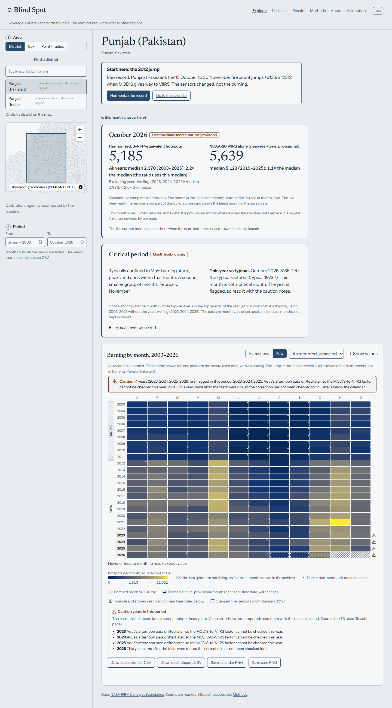

# Blind Spot: Space Apps 2026 project submission (draft)

**A district officer in Punjab who opens NASA's fire record sees Pakistani Punjab's October–November fire count jump +613% in 2012. The fields did not change; the satellites did. Blind Spot corrects the record and flags the years where the correction cannot be trusted.**

## Project name

Blind Spot

## Challenge

Harmonization of MODIS and VIIRS Hot Spots

## High-level summary

Each autumn, farmers across Punjab, in Pakistan and India, burn crop stubble, and district disaster and air-quality officers need to know one thing: is this season worse than usual? The obvious evidence is NASA's satellite fire record, which goes back to 2003. But in 2012 the record moved from the MODIS sensor to the sharper VIIRS, and Pakistani Punjab's October–November fire count jumped +613% at once (+371% in Indian Punjab). Read as it is, that looks like a burning crisis. It is a change of instrument.

Blind Spot puts MODIS and VIIRS on one scale, and the 2012 jump shrinks to +12.7% (Pakistan) and -6.1% (India). Pick any district and see its burning calendar from 2003 to October 2026, whether this month is unusual there, and when the season usually peaks. Where our own tests show the correction fails, the app says so in plain words.

## Link to Project Demo

Video, 30 seconds or less, English subtitles: link added when uploaded. It opens with no login, password or permission.

## Link to Final Project

Live app: https://blindspot-firms.pages.dev

Source code and data: https://github.com/Aiza166/BlindSpot-FIRMS

## Detailed description

### What it does

- **Pick a place and a period:** any of 347 districts, either Punjab, or a box or circle on the map; any range of months.
- **Read the burning calendar:** one row per year, one cell per month, raw or harmonized; near-real-time months are labelled provisional.
- **Ask "is this month unusual here?":** the latest month against that place's median for the same month, cross-checked with a second satellite (NOAA-20). The current month comes in live from NASA's near-real-time feed, labelled provisional.
- **See the critical period:** the months when burning usually starts, peaks and ends.
- **Take it with you:** CSV and PNG downloads, in colours safe for colour-blind readers.

**Example.** In Sangrur (Indian Punjab), November 2021 shows 1.74× its usual November, NOAA-20 agrees (1.94×), and the year is not flagged, so the officer can rely on it. November 2025 shows only 0.05×, but the app flags that year and gives the reason, so the officer reads it as fewer fires seen at the afternoon overpass, not necessarily fewer fires.

### How it works

NASA FIRMS detections are filtered to vegetation fires, with year-round heat sources such as brick kilns masked out. For each region and month we fit an Aqua-to-VIIRS factor on 2012–2021 only; before 2012 the record is Aqua times that factor, after it VIIRS as observed. We fixed three tests before running them: does the correction remove the 2012 jump (T1), has the ratio drifted since (T2), and if it fails, why (T3)?

### What we found, and the limits

The correction removes the 2012 jump in both regions. After 2021 it fails in Indian Punjab (only 1 of 4 held-out years fit). The evidence fits burning that moved later in the day, after the afternoon satellites pass, but we cannot separate later burning from less burning. Pakistani Punjab after 2021 is untested (T2 inconclusive); we changed one T2 rule after seeing data and report both verdicts. A hotspot count is an index of what satellites saw, not burned area. Test results are on the app's Results page, with full detail in `docs/RESULTS_T1.md` to `docs/RESULTS_T3.md`.

### What is new

Earlier studies reported a single MODIS-to-VIIRS ratio for Punjab (Vadrevu and Lasko 2018 found VIIRS saw 6.5 times as many fires as Aqua). Blind Spot turns that ratio into a tested correction for every region and month that tells you when not to trust it.

### Other regions

The method uses only global FIRMS inputs, so it can move to any farming region seen by both MODIS and VIIRS. A new region needs its own calibration and the same three tests before its numbers are shown; we have not added one yet.

### Tools and languages

Python (DuckDB, pandas, SciPy, Shapely) for the pipeline; TypeScript, Next.js, MapLibre and DuckDB-WASM for the app; Cloudflare Pages for hosting. No hardware. Claude Code (Anthropic) wrote most of the code under the team's direction.

### What was built when

The pipeline, its tests and a first app version were prepared before the event, with the Universal Event Local Lead's permission for local work as relayed to our team lead. During the event we added 2026, the 2012 story view, the live current month, wording fixes and the deploy; `ai-log.md` and `decisions.md` list every change.

## NASA data used

| Product | What we used it for | DOI |
|---|---|---|
| MODIS Collection 6.1 active fire detections, MCD14ML (Terra, Aqua), via FIRMS | 2003 onward history; Aqua is the calibration base | doi:10.5067/FIRMS/MODIS/MCD14ML |
| VIIRS S-NPP 375 m active fire, VNP14IMG, via FIRMS | Reference scale, 2012 onward | doi:10.5067/VIIRS/VNP14IMG.002 (LP DAAC V002 record; FIRMS SP archive has no separate DOI found) |
| VIIRS NOAA-20 375 m active fire, VJ114IMG, via FIRMS | Second VIIRS series; month card | doi:10.5067/VIIRS/VJ114IMG.002 (LP DAAC V002 record; same note) |

Acknowledgement: "We acknowledge the use of data and imagery from LANCE FIRMS operated by NASA's Earth Science Data and Information System (ESDIS)."

## Space agency partner data and other references

No data from the 2026 Space Agency Partners. Other data:

| Data | Licence | Use |
|---|---|---|
| geoBoundaries gbOpen, Pakistan ADM1 and ADM2 | Public Domain | Regions, districts |
| geoBoundaries gbOpen, India ADM1 | CC BY 2.5 IN (DataMeet India) | Indian Punjab region |
| geoBoundaries gbOpen, India ADM2 | ODbL 1.0 (Pathways Data Pvt. Ltd.); our simplified `districts.geojson` is shared under ODbL 1.0 too | Districts |

Full licence text: the app's Attribution page and `web/public/data/ATTRIBUTION.md`.

Software, all open source: DuckDB and DuckDB-WASM (MIT), MapLibre GL JS (BSD-3-Clause), Next.js and React (MIT), pandas, SciPy and Shapely (BSD-3-Clause), PyArrow (Apache-2.0), marked and html-to-image (MIT), and the Instrument Sans and Newsreader fonts (SIL Open Font License) via Fontsource. The agent and skill files in `.claude/` are adapted from ECC (`.claude/ECC-ATTRIBUTION.md`). All screenshots are our own captures of the app. We used no copyrighted images or text from other sources.

## Use of Super Intelligence (SI)

We used Claude Code (Anthropic), including subagents, for:

- research (FIRMS formats, overpass times, licences),
- writing pipeline and web code and tests,
- code, security and accessibility reviews, and red-team critiques of the plan and results,
- first drafts of documents, including this one and the video script.

People on the team chose the research question, the scope, the pre-registered tests and thresholds, and approved each change. Every number in the app and in this text is read from pipeline output files by a script. The demo video was assembled with AI (Claude Code, brag, Hyperframes) from real screenshots of the live app: no AI-generated images. Its narration is AI-generated speech (Kokoro TTS), not a recorded voice. As the 2026 guide asks for code and data, SI use is also stated in the README, on the app's About page, and in the package metadata (`pyproject.toml`, `web/package.json`).

## References

- Giglio, L., Schroeder, W., Justice, C. O. (2016). The collection 6 MODIS active fire detection algorithm and fire products. Remote Sensing of Environment 178, 31–41.
- Schroeder, W., Oliva, P., Giglio, L., Csiszar, I. A. (2014). The new VIIRS 375 m active fire detection data product. Remote Sensing of Environment 143, 85–96.
- Vadrevu, K., Lasko, K. (2018). Intercomparison of MODIS AQUA and VIIRS I-Band Fires and Emissions in an Agricultural Landscape. Remote Sensing 10(7), 978. doi:10.3390/rs10070978.
- NASA Earth Observatory (15 Dec 2025). New Timing for Stubble Burning in India (H. Jethva).
- Singh, N., Pradhan, R., Shukla, B. P., Pandya, M. R. (2025). Evidence of shift in stubble burning timing over northwest India from geostationary satellite observations. Current Science 129(10), 921–923.
- Runfola, D. et al. (2020). geoBoundaries: A global database of political administrative boundaries. PLoS ONE 15(4): e0231866.
- NASA FIRMS: https://earthdata.nasa.gov/firms

Each number above traces to a results file; the list is SUBMISSION_SOURCES.md in the repository.
