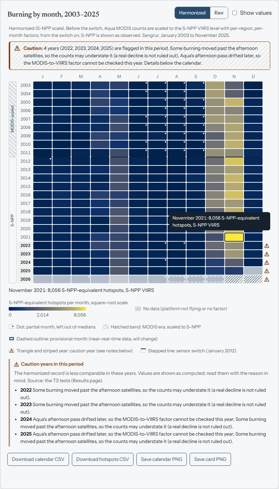
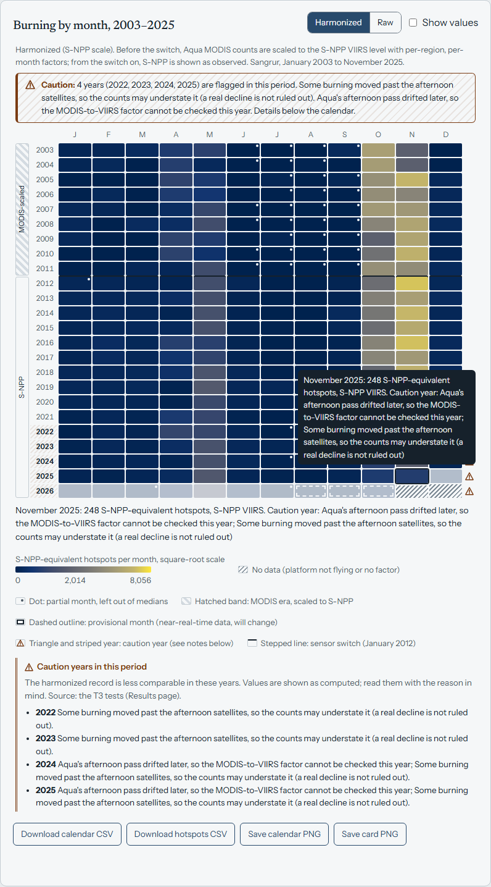
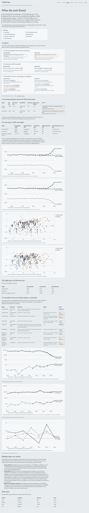

# Blind Spot: Space Apps 2026 project submission (draft)

**Pakistani Punjab's fire record jumps +613% in the October–November burning season of 2012, when the record switches from MODIS to VIIRS; Blind Spot brings it to +12.7% and flags the years where it stops being comparable.**

## Project name

Blind Spot

## Challenge

Harmonization of MODIS and VIIRS Hot Spots

## High-level summary

When NASA's VIIRS sensor joined MODIS in 2012, the satellite fire record for Punjab jumped. Over the same fields and the same days (15 Oct–30 Nov 2012), S-NPP VIIRS counted +613% against Aqua MODIS in Pakistan and +371% in India. The jump coincides exactly with the sensor switch. Blind Spot puts NASA FIRMS MODIS and VIIRS detections on one VIIRS-equivalent scale; the jump falls to +12.7% (Pakistan) and -6.1% (India), within normal year-to-year spread. The app shows a burning calendar for any district in Pakistani and Indian Punjab and the area around them, 2003–2026. From 2022 the record is less comparable: in Indian Punjab some burning moved past the afternoon satellites; those years are flagged.

We wrote the tests and thresholds before running them. We changed one T2 rule after seeing data and disclose it below, with both verdicts.

## Link to Project Demo

Video, 30 seconds or less, English subtitles: link added when uploaded. It opens with no login, password or permission.

## Link to Final Project

Live app: link added after the deploy (Cloudflare Pages).

Source code and data: https://github.com/Aiza166/BlindSpot-FIRMS

## Detailed description

### What it does

- Pick one of 347 districts (geoBoundaries ADM2), a region preset, or draw a box or radius.
- See a calendar of burning with one cell per month and one row per year, raw or harmonized, with sensor eras shaded so you can see where the record changes.
- Compare a month with its usual level for that place, both with all years and with the years we flag left out.
- See the critical period of a district or region: the months in the top quarter of the year, with onset, peak and end (month level, not daily).
- Download the calendar or the filtered hotspots as CSV (up to 200,000 rows), or the chart as PNG.

**Example: Sangrur (November 2021) and Kasur (November 2021).** For each district we took the highest-burning November since 2012 in a year that is not on our caution list (rule fixed in `docs/DECISIONS.md` D-042 before choosing). A district officer in Sangrur (Indian Punjab) asks whether that November was unusual. The harmonized calendar shows 8,056 S-NPP-equivalent hotspots against a 2003–2025 November median of 4,617 (1.74× the median, or 1.62× against 4,988, the median with the years we flag left out). NOAA-20, a second VIIRS satellite on the same afternoon orbit, saw 7,892 against its own 2019–2025 median of 4,059 (1.94×). Sangrur's 2021 carries no caution flag, so the comparison stands. Across the border in Kasur (Pakistani Punjab), November 2021 shows 393 against a 2003–2025 median of 203 (1.94×, or 1.84× with the flagged years left out), with NOAA-20 at 1.76× its median; also unflagged.

**Contrast: November 2025, a flagged year.** The same districts in November 2025 look very different: Sangrur 248 hotspots (0.05× its median) and Kasur 82 (0.40×). Both years are on our caution list (Sangrur: Aqua's overpass drift and later burning; Kasur: Aqua's overpass drift), so the officer reads "far fewer fires seen at 13:30", not "far fewer fires". The app shows the caution banner and the flag in words.

### How it meets the brief

| The challenge asks for | Blind Spot |
|---|---|
| Select an area of interest | District list (347 districts), region presets, or draw a box or radius on the map |
| Choose a date range | Start and end month controls; the calendar and CSV follow them |
| Calendar view, 2000s to present | Year-by-month calendar (one cell per month), 2003–2026 |
| Current month against the median | Month card: latest available month (labelled "not live"; the live current month appears when the near-real-time service is switched on at launch) against that place's median for the same month, with all years and excluding the years we flag, plus NOAA-20 against its own median |
| Critical periods | Panel per district and region: onset, peak and end month of the months in the top quarter of the year, and this year against typical; month level, not daily |
| Accessible colour ramps | Cividis (colour-vision-deficiency safe); flags shown by a triangle, stripes and text, not colour alone; axe-core found 0 violations across 24 runs (pages × light/dark × desktop/phone) |
| Download data | CSV of the calendar or of filtered hotspots (up to 200,000 rows) |
| Download images | Chart as PNG |

### How it works

1. **Data.** FIRMS standard archive for MODIS (Terra, Aqua) and VIIRS (S-NPP, NOAA-20), clipped to 60–80°E, 23–37°N.
2. **Filters.** Vegetation fires only (`type` 0), MODIS confidence 30 or higher, VIIRS nominal or high confidence, dates in local solar time. A persistent-hotspot mask removes 194 grid cells with year-round heat sources (kilns, flares) from every series.
3. **Calibration.** For each of 3 regions (Pakistani Punjab, Indian Punjab, and the rest of the study area) and each month we fit an Aqua MODIS to S-NPP VIIRS factor on 2012–2021 only, with a bootstrap by year. Example: Indian Punjab, October, 4.362; Pakistani Punjab, October, 7.009. Districts do not get factors of their own: each detection takes the factor of the calibration region it falls in, so a district with few fires inherits a stable regional factor. Districts also inherit that region's reliability flags; a drawn area takes the flags of every region it overlaps.
4. **Splice.** Before S-NPP, the series is Aqua times the factor; from S-NPP onward it is S-NPP as observed. We never add platforms together. NOAA-20 (from 2019) is not in the harmonized series. We use it for two things: a same-sensor check on the latest month (NOAA-20 against its own median, in the month card), and a stability test of S-NPP itself (below).
5. **Tests, fixed in advance** (window 15 Oct–30 Nov, Pakistani and Indian Punjab reported separately):
   - T1: the harmonized 2012 step must be under 10% of the raw step. Ratio: 0.021 (Pakistan), 0.016 (India). Both pass. Then, if T2 finds no drift, held-out years 2022–2025 must fall inside a 95% prediction interval.
   - T2: does the Aqua/S-NPP ratio drift after 2021 once you control for overpass time? Both satellites cross in the early afternoon, but Aqua's crossing has drifted later in recent years. We compare only days when the two passed within 30 minutes of each other.
   - T2b: VIIRS night share and the Terra/Aqua ratio by year, as a consistency check.
6. **App.** A static Next.js site. MapLibre draws the map; DuckDB-WASM reads Parquet hotspot tiles in your browser, so a custom area needs no server.

### Tools and languages

- Pipeline: Python 3.11 with DuckDB, pandas, PyArrow, SciPy and Shapely; Parquet files; pytest and ruff.
- Web app: TypeScript, Next.js 15 and React 19 as a static site, MapLibre GL JS for the map, DuckDB-WASM for queries in the browser, html-to-image for the PNG export.
- Hosting: Cloudflare Pages, with one Pages Function that fetches near-real-time FIRMS data so the key stays on the server.
- Checks: pytest, vitest, browser end-to-end tests (`web/e2e`), axe-core for accessibility.
- No hardware.
- Claude Code (Anthropic) wrote most of the code and tests under the team's direction; see "Use of Super Intelligence (SI)" below and the app's About page.

### Results, stated plainly

| Test | Pakistani Punjab | Indian Punjab |
|---|---|---|
| T1: does harmonizing remove the 2012 jump, and do 2022–2025 stay in the prediction interval? | **pass (2012 step only; held-out not judged because T2 is inconclusive)**. Step ratio 0.021 (must be < 0.10). | **fail (2012 step pass; held-out judged because T2 is no drift: fail)**. Step ratio 0.016 passes; only 1 of 4 held-out years sit inside the 95% interval. |
| T2: does the Aqua/S-NPP ratio drift after 2021 on days the two passed within 30 minutes? | **inconclusive**: 1 of 4 test years have enough matched days. | **no drift** on matched days (2 of 4 years usable); the failure comes from days Aqua passed later. |
| T3: why does it fail? O = Aqua's later overpass, T = burning moved later, D = less burning | O supported, T not supported, D not supported. Flagged: 2023–2025. | O cannot separate, T supported, D cannot separate. Flagged: 2022–2025. |

In short: the correction removes the 2012 jump in both regions; after 2021 it fails in Indian Punjab, is untested in Pakistani Punjab, and the app flags those years.

Both satellites cross Punjab in the early afternoon (about 13:30 local), but Aqua's crossing has drifted later in recent years. T1 judges held-out years only if T2 finds no drift, which is why T2 decides the second half of T1.

**Is the remaining 2012 step small?** The Aqua→S-NPP factor varies from year to year with a standard deviation of 0.126 (Pakistan) and 0.071 (India) in log units over 2013–2021. The harmonized 2012 steps are 0.95 and 0.88 of those standard deviations: inside normal year-to-year spread.

**Does the factor hold before 2012?** We apply it back to 2003, where only MODIS exists. Terra and Aqua carry the same MODIS sensor at different times of day, so a trend in Terra/Aqua over 2003–2011 would warn that Aqua's view of burning was changing. Theil–Sen slopes: -3.7% per year (Pakistan, CI -16.8% to +5.5%) and -4.5% (India, -9.3% to +0.1%). Both intervals include zero, so we found no trend; India's upper bound sits close to zero, so a slow decline is possible.

**Is S-NPP itself stable?** NOAA-20 and S-NPP carry the same VIIRS instrument on the same afternoon orbit. Their ratio over 2019–2025 moved -0.6% per year in Pakistan and +0.5% in India (CIs include zero). A change in S-NPP counts after 2021 is therefore a change in what the afternoon orbit saw, not sensor decay.

**What T3 shows for Indian Punjab.** S-NPP daytime detections in the window changed -77% in 2022–2025 against 2012–2021, while night detections rose +363% and the night share went from at most 0.1% to 1.0%. A model of Aqua's overpass gap, fit on 2012–2017, leaves a +61% residual in Indian Punjab (+9% in Pakistan), so orbit drift alone does not explain India. Burning later (T) fits, and two geostationary studies report the same shift (Jethva/NASA Earth Observatory 2025; Singh et al. 2025). **We cannot separate T from D.** Night detections are about 1.0% of the total, so later burning alone may not account for the daytime fall; a real decline may also be present, and our data cannot size the two.

### Benefits

- Disaster and air-quality teams in Pakistan and India get a burning history for their own district that does not break in 2012.
- Researchers get a correction factor per region and month, with intervals. It passes the 2012 test in both regions; after 2021 it fails in Indian Punjab and is untested in Pakistani Punjab, and the app flags those years.
- You can download every series as CSV.

### What is new

Earlier work compared MODIS and VIIRS fire counts once and reported a ratio: Vadrevu and Lasko (2018) found VIIRS detected 6.5 times as many fires as Aqua in Indian Punjab; our factor for 2013–2018 in the 15 Oct–30 Nov window is 5.02. Separate studies found Punjab burning moved later in the day (Jethva 2025; Singh et al. 2025). Blind Spot joins the two: a correction that reports where it stops working. Each region-year carries a test result, and the calendar shows a flag with a plain-words reason on the years where the factor can no longer be trusted.

### What was built when

- **Before the hackathon:** the data pipeline, its tests and a first version of the web app were prepared locally. Our team lead was told by the Universal Event Local Lead that local work, data download and a written plan were allowed.
- **During the hackathon (14–15 Nov 2026):** first build and test run on Windows; wording fixes with new tests; the app now opens on the 2012 story with one button to harmonize; a new pipeline step that adds 2026 without changing 2003–2025, with near-real-time months marked provisional. Every change is listed in `ai-log.md` and `decisions.md` in the repository.

### Limits (honest list)

- **Counts are an index.** A hotspot count tracks how much burning a satellite saw at its overpass times. It is not burned area, not fire numbers on the ground, and not emissions.
- **Pakistani Punjab T2 is inconclusive.** We cannot yet say whether the factor holds there after 2021.
- **Indian Punjab T1 fails** on the held-out years. The 2012 correction works; after 2021 the afternoon satellites miss fires lit later in the day, and we cannot tell how much burning also fell.
- **No independent check against non-FIRMS data yet.** We have not compared with official stubble-fire counts. We rejected MCD64A1 burned area: it picks its training pixels from MODIS active fires, so the check would be circular, and its grid cells are too coarse for small paddy fields. The 2003–2011 Terra/Aqua check is indirect.
- **Tested only in Punjab.** We chose Punjab because its post-monsoon stubble burning is dense and well studied, so a sensor jump shows clearly. The method uses only global FIRMS inputs, and it fits one factor per region and month, so extending it means drawing new calibration regions and rerunning the same tests there. We have not done that yet.
- **We changed the T2 verdict rule after seeing data** (minimum evaluable years, a control region). We logged the change and report the original verdict beside the revised one.
- **Near-real-time data is not live.** The month card shows the latest complete archive month, labelled "not live". Live NRT needs a server function we have not deployed.
- **Custom areas use simplified Punjab outlines.** For a test box on the border, 1 of 83 months differed from the full pipeline, by at most 4.7%.
- **Coverage:** Pakistan and northern India only.

## NASA data used

| Product | What we used it for | DOI |
|---|---|---|
| MODIS Collection 6.1 active fire detections, MCD14ML (Terra, Aqua), via FIRMS | 2003 onward history; Aqua is the calibration base | doi:10.5067/FIRMS/MODIS/MCD14ML |
| VIIRS S-NPP 375 m active fire, VNP14IMG, via FIRMS | Reference scale, 2012 onward | doi:10.5067/VIIRS/VNP14IMG.002 (LP DAAC V002 record; FIRMS SP archive has no separate DOI found) |
| VIIRS NOAA-20 375 m active fire, VJ114IMG, via FIRMS | Second VIIRS series; month card | doi:10.5067/VIIRS/VJ114IMG.002 (LP DAAC V002 record; same note) |

Acknowledgement: "We acknowledge the use of data and imagery from LANCE FIRMS operated by NASA's Earth Science Data and Information System (ESDIS)."

## Space agency partner data and other references

No data from the 2026 Space Agency Partners. Other data:

| Data | Licence | Use |
|---|---|---|
| geoBoundaries gbOpen, Pakistan ADM1 and ADM2 | Public Domain | Regions, districts |
| geoBoundaries gbOpen, India ADM1 | CC BY 2.5 IN (DataMeet India) | Indian Punjab region |
| geoBoundaries gbOpen, India ADM2 | ODbL 1.0 (Pathways Data Pvt. Ltd.); our simplified `districts.geojson` is shared under ODbL 1.0 too | Districts |

Full licence text: the app's Attribution page and `web/public/data/ATTRIBUTION.md`.

Software, all open source: DuckDB and DuckDB-WASM (MIT), MapLibre GL JS (BSD-3-Clause), Next.js and React (MIT), pandas, SciPy and Shapely (BSD-3-Clause), PyArrow (Apache-2.0), marked and html-to-image (MIT), and the Instrument Sans and Newsreader fonts (SIL Open Font License) via Fontsource. The agent and skill files in `.claude/` are adapted from ECC (`.claude/ECC-ATTRIBUTION.md`). All screenshots are our own captures of the app. We used no copyrighted images or text from other sources.

## Use of Super Intelligence (SI)

We used Claude Code (Anthropic), including subagents, for:

- research (FIRMS formats, overpass times, licences),
- writing pipeline and web code and tests,
- code, security and accessibility reviews, and red-team critiques of the plan and results,
- first drafts of documents, including this one and the video script.

People on the team chose the research question, the scope, the pre-registered tests and thresholds, and approved each change. Every number in the app and in this text is read from pipeline output files by a script. We used no AI-generated images, video or voice. As the 2026 guide asks for code and data, SI use is also stated in the README, on the app's About page, and in the package metadata (`pyproject.toml`, `web/package.json`).

## References

- Giglio, L., Schroeder, W., Justice, C. O. (2016). The collection 6 MODIS active fire detection algorithm and fire products. Remote Sensing of Environment 178, 31–41.
- Schroeder, W., Oliva, P., Giglio, L., Csiszar, I. A. (2014). The new VIIRS 375 m active fire detection data product. Remote Sensing of Environment 143, 85–96.
- Vadrevu, K., Lasko, K. (2018). Intercomparison of MODIS AQUA and VIIRS I-Band Fires and Emissions in an Agricultural Landscape. Remote Sensing 10(7), 978. doi:10.3390/rs10070978.
- NASA Earth Observatory (15 Dec 2025). New Timing for Stubble Burning in India (H. Jethva).
- Singh, N., Pradhan, R., Shukla, B. P., Pandya, M. R. (2025). Evidence of shift in stubble burning timing over northwest India from geostationary satellite observations. Current Science 129(10), 921–923.
- Runfola, D. et al. (2020). geoBoundaries: A global database of political administrative boundaries. PLoS ONE 15(4): e0231866.
- NASA FIRMS: https://earthdata.nasa.gov/firms

Each number above traces to a results file; the list is SUBMISSION_SOURCES.md in the repository.
